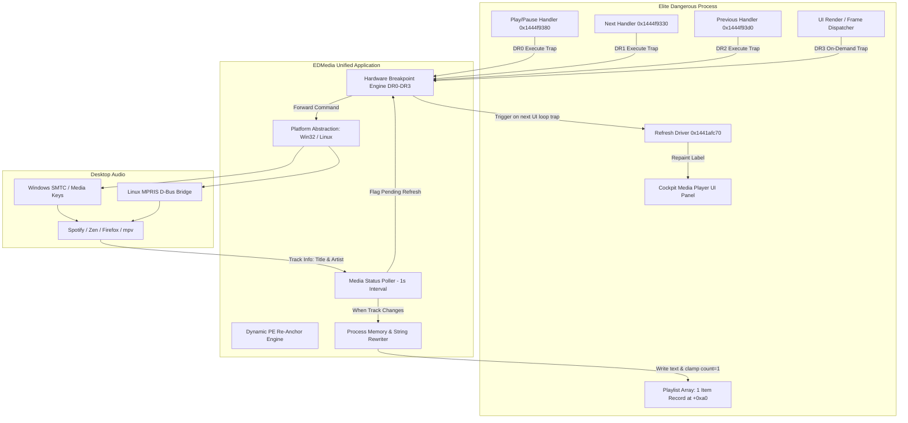

# EDMedia

**A Complete Functional Replacement for the Elite Dangerous GalNet Cockpit Media Player**

[]()
[]()
[]()

EDMedia replaces the in-game GalNet audio player in **Elite Dangerous** (Odyssey & Horizons 4.0+) with a real-time bridge to your desktop media player (Spotify, Firefox/Zen, Chrome, mpv, VLC, etc.).

---

## Features

- 🎵 **Cockpit Media Controls**: Pressing **Play/Pause**, **Next**, or **Previous** in the ship cockpit directly controls your active desktop audio player.
- 📜 **Single Active Playlist Entry**: Replaces the multi-item GalNet news articles list with **exactly one active entry** showing the currently playing track's **Title** and **Artist**.
- 🔄 **Dynamic Cockpit Updates**: When tracks change in the background (or finish playing), the cockpit display updates automatically without requiring manual button presses or reopening panels.
- 🛡️ **Queue Advancement Suppression**: Suppresses internal engine index progression on track skips (`Next` / `Previous`), preventing the game from advancing to stale or vanilla GalNet articles and keeping the cockpit parked smoothly on Item 0.
- 🥷 **Anti-Tamper & WatchDog Safe**: Uses CPU **Hardware Execution Breakpoints (`DR0`-`DR3`)** and OS debugging APIs. **Zero bytes in `.text` are modified**, avoiding watchdog violations, memory integrity hash checks, or anti-tamper triggers.
- 🎯 **Dynamic PE Re-Anchoring**: Scans `EliteDangerous64.exe` dynamically on startup to resolve interface slots, button trampolines, and vtables with 100% confidence, ensuring full compatibility across game updates.
- 🐧🪟 **Cross-Platform**: First-class support for **Linux** (native `ptrace` and MPRIS D-Bus), **Windows** (Win32 debugging and SMTC / media keys), and **Proton / Wine** (local loopback bridge).

---

## Architecture Overview



---

## Technical Reverse Engineering Foundations

### 1. The Single-Item Playlist Array
Inside the `AudioPlayer` object (`this` / `RCX` / `RDI`):
- `+0xa0`: Vector start pointer (`array_start`)
- `+0xa8`: Vector end pointer
- `+0xb0`: Start index (`uint64`)
- `+0xb8`: **Item count** (`uint64`)
- `+0x228`: Capacity limit (`uint32`)
- `+0x22c`: Active flag (`uint8`)

Each item in the array is a **40-byte (`0x28`) record**:
```
Offset       Type       Description
---------------------------------------------------------------
+0x00        uint64*    Pointer to Title refcounted string object
+0x08        uint64*    Pointer to Secondary/Audio ID string object
+0x10        uint8[4]   Item status flags (01 = ready, 02 = playing)
+0x14        uint8[4]   Compiler alignment padding
+0x18        uint64*    Pointer to metadata string object
+0x20        uint32     Duration in seconds
+0x24        uint32     Record alignment padding
```

### 2. Refcounted String Objects
Elite Dangerous strings are stored in custom heap objects:
- `T - 0x14`: Length in bytes (including terminating NUL)
- `T - 0x0c`: Capacity in bytes
- `T - 0x04`: Reference count (**Must be preserved at 3 for active UI strings**)
- `T`: UTF-8 string content + NUL terminator

### 3. Queue Advancement Suppression
When Next (`DR1`) or Previous (`DR2`) traps, EDMedia forwards the skip command to the desktop media player, then redirects `RIP` to the return address `[RSP]` and advances `RSP += 8`. This suppresses the engine's internal call to `call *0x150(%rax)`, preventing the game from stepping through GalNet articles.

---

## Quickstart & Usage

### 1. Installation
Install dependencies in your Python environment:
```bash
pip install -e .
```

### 2. Run the Background Daemon
Launch EDMedia before or after starting Elite Dangerous:
```bash
edmedia run
```
The daemon will automatically detect `EliteDangerous64.exe`, attach hardware breakpoints to all game threads, and sync cockpit controls with your desktop audio player.

### 3. Verify Dynamic Re-Anchoring
To verify that your installed game binary matches all required hooks:
```bash
edmedia reanchor
```
Output:
```text
==============================================================================
EDMedia Dynamic Re-Anchor Report (ImageBase: 0x140000000)
Confidence: 100.0%
==============================================================================
Target Name                      Slot       RVA            Static VA          Status
------------------------------------------------------------------------------
AudioPlayerOnPlayPauseToggle     0x140      0x44f9380      0x1444f9380        OK (100%)
AudioPlayerOnPrevious            0x148      0x44f93d0      0x1444f93d0        OK (100%)
AudioPlayerOnNext                0x150      0x44f9330      0x1444f9330        OK (100%)
AudioPlayerOnClearPlaylist       0x168      0x44f92e0      0x1444f92e0        OK (100%)
RefreshDriver                    -          0x41afc70      0x1441afc70        OK (100%)
RefreshVtable                    +0xa0      0x5579990      0x145579990        OK (100%)
==============================================================================
```

### 4. Test Media Controls
Test desktop player detection and transport controls directly from the terminal:
```bash
# Query currently playing track
edmedia media status

# Toggle Play/Pause
edmedia media play-pause

# Skip to Next / Previous track
edmedia media next
edmedia media prev
```

### 5. Proton / Wine Bridge
When running inside Proton with a desktop media player running on the Linux host:
- On Linux Host:
  ```bash
  edmedia bridge
  ```
- Inside Wine Prefix: `edmedia.exe` automatically connects to the host on `127.0.0.1:48231`.

---

## Building Executables

To produce a standalone single-file binary with PyInstaller:
```bash
python build_exe.py
```
Produces `dist/edmedia` (or `dist/edmedia.exe` on Windows).

---

## Running the Automated Test Suite

Run all unit and integration tests:
```bash
python -m unittest discover tests -v
```

---

## License
MIT License.
